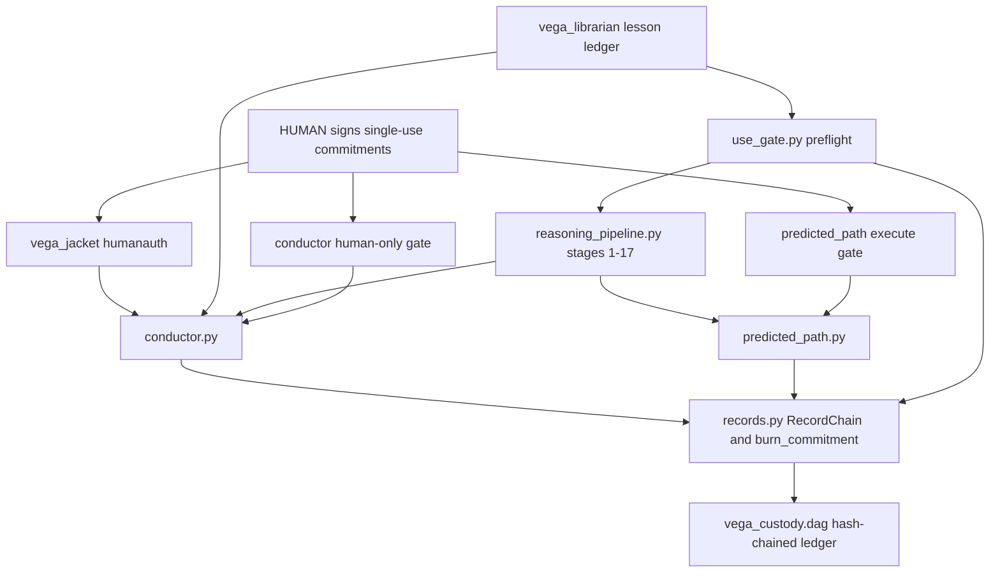

# vega-harness-sdk — Architecture

## 1. The organism

This kit is layer 6 (conduct) of a 16-layer family. Every SDK owns exactly one concern and uses the owner of every other concern instead of growing its own copy.

```
                 ┌──────────────────────────┐
                 │   THE HUMAN (the owner)  │  holds the only signing key;
                 │  authority starts here   │  spends it one action at a time
                 └────────────┬─────────────┘
                              v single-use signed commitments
 15 assemble   vega-umbrella-sdk        the family as one organism
 14 deliberate vega-council-sdk         multi-brain deliberation (depends on harness)
               vega-galaxy-sdk          the galaxy view of the knowledge lattice
 13 watch      vega-governance-feed-sdk live view of every chain + tamper alarms
 12 verify     vega-metacog-sdk         evidence rungs and the completion gate
 11 reason     vega-reasoning-sdk       fidelity, forecasting, routing: the lattice
                                        that predicts steps ahead
 10 observe    vega-trace-sdk           telemetry of reasoning
  9 interface  vega-terminal-sdk        gated command execution
  8 learn      vega-train-sdk           governed training (depends on harness)
  7 knowledge  vega-dkg-lattice-sdk     the knowledge graph: every fact with origin
                                        and licence; repo-library processing
>>> 6 conduct  vega-harness-sdk         THIS REPO: deterministic workflow conduct,
                                        pre-registered predicted paths, library
                                        use gate <<<
  5 memory     vega-librarian-sdk       lessons and memory of past incidents
  4 contain    vega-two-gate-sdk        containment between two gates + hard stop
  3 adapt      vega-pareah-sdk          adapters, cards, quarantine of inbound code
  2 seal       vega-superproof-sdk      layered sealing and proof tiers
  1 authority  vega-governance-jacket-sdk human-only actions, single-use signed
                                        commitments, entry and exit gates
  0 record     vega-custody-sdk         capsules, DAG, hash-chained ledger — the
                                        foundation everything writes to
```

**What the layers below provide, as actually imported in this repo's src/:** custody (layer 0) provides the hash-chained append-only DAG (`records.py` imports `vega_custody.dag`); jacket (layer 1) provides the human-only classification of step names and verbs (`conductor.py` imports `vega_jacket.humanauth`) and the WCOMMIT ledger this kit's gates check; librarian (layer 5) provides the lesson ledger (`use_gate.preflight` imports `vega_librarian.lesson_ledger`; the Conductor consumes it through an injected preflight callable).

**Who above consumes it:** vega-train-sdk (layer 8) and vega-council-sdk (layer 14) list this kit in their registry dependencies. This repo never imports upward — dependencies point down layers only, never up or sideways.

## 2. Internal drawing — modules and flows

Boxes are real module names in `src/vega_harness/`. Authority flow (A) and data flow (D) are marked separately: **authority flows only from the human-signed commitment through the gates; data flows through records.**

```
            HUMAN (outside this repo)
              |  signs WCOMMIT commitments with a key the model never holds
              |
              v (A)
   +-----------------------+        (A) commitment + checker        +--------------------+
   |  vega_jacket.humanauth|-------------------------------------->|    conductor.py    |
   |  human-only classes   |        (A) burn via records           |  deterministic run |
   +-----------------------+                                       |  no model inside   |
                                                                   +----+-----+---------+
   +-----------------------+   (D) lessons for risky verbs              |     |
   | vega_librarian lesson |-------------------------------------------+     | (A) stage 18 is HUMAN_ONLY;
   | ledger (via use_gate  |        (D) preflight results into ctx            |     frozen spec needs a
   | .preflight / injected)|                                                  |     SECOND commitment
   +-----------------------+                                                  v
                                                                   +---------------------+
   +-----------------------+   (D) library candidates, use cards | reasoning_pipeline  |
   |      use_gate.py      |<------------------------------------|  stages 1-17 build  |
   | card / splice/release |        (D) containment decision      |  a blueprint; s16b  |
   +-----------------------+                                      |  freezes the path   |
              ^                                                   +----------+----------+
              | (A) splice/release gate verdicts                             | (D) freeze / run
              |                                                              v
              |                                                   +---------------------+
              |                                                   |  predicted_path.py  |
              |                                                   | freeze -> compare   |
              |                                                   | halt + recover      |
              |                                                   +----------+----------+
              |                                                              |
              v (D) every record: runs, candidates, replays, freezes,        v (D)
   +-----------------------------------------------------------------------------+
   |                              records.py                                     |
   |  RecordChain (append / append_unique / verify) + burn_commitment            |
   +--------------------------------------+--------------------------------------+
                                          | (D) append-only, hash-chained
                                          v
   +-----------------------------------------------------------------------------+
   |                        vega_custody.dag (layer 0)                           |
   +-----------------------------------------------------------------------------+
```

Data flow summary: steps and stages produce context → context is hashed into run records → records land on the custody chain → frozen specs, step outcomes, incidents and burns are records too → anyone can re-verify the chain without trusting the model.

Authority flow summary: the human signs → jacket classifies what is human-only → the conductor gate and the frozen-spec gate each check a commitment for exactly their action and burn it → nothing else in this repo can create or widen authority.

## 3. Mermaid version



## 4. Sequence — the main scenario end to end

A request is planned, frozen, and executed only under two human commitments:

```
caller          reasoning_pipeline      conductor          predicted_path        records/custody
  |  plan(req, execute=True) |               |                    |                     |
  |------------------------->|               |                    |                     |
  |                          | build stages 1-18 as Steps          |                     |
  |                          |--------------->|                   |                     |
  |                          |               | per step: preflight lessons (risky verbs)|
  |                          |               |--------------------------------------->  |
  |                          |               | s01..s17 run; every candidate challenged |
  |                          |               | s16b: freeze(spec) |                     |
  |                          |               |------------------->|  PATH_FROZEN record |
  |                          |               |                    |-------------------->|
  |                          |               | s18 is HUMAN_ONLY: needs commitment #1   |
  |        commitment #1 (step)  ------------>| check + BURN       |                     |
  |                          |               |------------------->| run(spec)           |
  |        commitment #2 (exact spec hash) --->|------------------->| check + BURN       |
  |                          |               |                    | per step: act,      |
  |                          |               |                    | compare to frozen   |
  |                          |               |                    | ON_PATH / ALT /     |
  |                          |               |                    | OFF_PATH: halt +    |
  |                          |               |                    | recover + INCIDENT  |
  |                          |               |                    |-------------------->| STEP/INCIDENT/RUN_DONE
  |                          |               | verify(ctx) is exactly True              |
  |                          |               | RUN record + WORKFLOW_CANDIDATE_PRE      |
  |                          |               |--------------------------------------->  |
  |  blueprint + run record + execution result |                   |                     |
  |<-------------------------|<--------------|                    |                     |
```

Later, `conductor.replay` re-runs the workflow without registering a new candidate and appends `WORKFLOW_REPLAY`: status `locked` only if the result hash equals the FIRST candidate's exactly.

## 5. Trust boundaries

| Boundary | Where trust changes hands | What enforces it |
|---|---|---|
| Human → kit | A signed WCOMMIT enters the process | `records.make_ledger_check`: exact action, unexpired, ledger-verified; any checker crash = refusal |
| Model → gate | A model-supplied step or dep output reaches a gate | Gates accept only exact `True` / exact shapes; loose truthy values fail (`conductor` verify, `predicted_path` custom checks) |
| Step → record | Runtime values become evidence | `records.canon` refuses non-JSON data (no memory addresses); custody refuses credential-shaped values; records hold hashes, not secrets |
| Gate → commitment store | A commitment is spent | `append_unique` is atomic first-writer-wins across processes; `Duplicate` refuses reuse; one shared burn chain per deployment |
| Prediction → reality | An observation is judged against the frozen spec | The spec hash was recorded before any effect; descriptors are strict and single-test; exceptions are OFF_PATH, never ON_PATH |
| This kit → dependencies | custody chain integrity, jacket classification, librarian lessons | Direct imports of layer 0/1/5 owners only; a failing preflight stops the run instead of trusting the step |
| Library code → build | Third-party source enters a build | `use_gate`: public = clean-room only; personal = quarantine + taint with strictest class; release needs everything stated |
