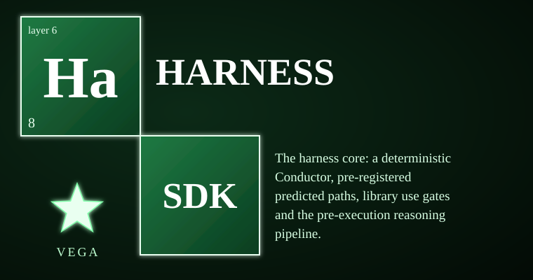

# vega-harness-sdk



This kit owns one concern: **deterministic workflow conduct, pre-registered paths and the library use gate.** It runs a workflow step by step with no model inside the loop, freezes the expected path before anything touches the world, and gates every use of third-party code. The failure it prevents is the quiet one: an agent workflow that "mostly works" but skips a lesson check, reuses an old approval, re-explains a surprise as expected, or splices restricted code into a public build — and none of it is written down anywhere you can verify.

> **Licensing.** Source-available, not open source. Free for personal use; free for registered small businesses (under US$1M revenue and valuation); everyone else needs a commercial license (see LICENSE; for a commercial license write to jasonblasiak.ai.mail@gmail.com). Patent pending. Draft licence text, not yet reviewed by an attorney.

Package: `vega_harness` (src layout). Depends on: vega-custody-sdk, vega-governance-jacket-sdk, vega-librarian-sdk.

## Why this exists

A model can reason, plan and draft all day, and none of that is a problem. The problem starts when reasoning turns into effects: files changed, code spliced, commands run. At that point the usual controls are promises. "The agent will follow the workflow" is a prompt. "It will check the lessons first" is a policy. "It will stop when surprised" is a hope. A promise is enforced by the same thing it is supposed to constrain, and it leaves no record you can check afterwards.

This kit replaces the promises with machinery. The **Conductor** is a deterministic sequencer: it contains no model call and no generative reasoning — models appear only inside steps the caller supplies. Before each risky step it consults the lesson ledger; a step marked human-only (or declaring a human-only verb — a step cannot dodge the gate by calling itself ordinary) runs only against a valid, single-use, human-signed commitment for exactly that step. Every run is hashed and appended to a chain, and a workflow is locked as reusable only if a replay reproduces the first run's result hash exactly.

**Predicted paths** handle surprise honestly. Before the first effect, the expected path is written down and frozen to a ledger. Reality is then compared to the frozen prediction, so a surprise can never be re-explained as "it fit all along". Anything unforeseen halts the run and triggers a prepared recovery — and a spec with side effects but no prepared recovery is refused at freeze time. No parachute, no jump. The **use gate** does the same for third-party code: public builds are clean-room only, personal builds run contained and their output is marked tainted.

Everything lands in an append-only, hash-chained record — hashes and verdicts, never secrets — so a third party can check what happened without trusting the model, the operator, or this project.

## Capabilities

| Capability | How you can check it |
|---|---|
| Deterministic workflow conduct with no model in the loop | `conductor.py` (module contains no model call by design); `tests/test_harness.py::ConductorTests`, `tests/redteam_1_conductor.py` |
| Human-only gate: single-use commitments, burned so one signature authorises one step once | `conductor.py`, `records.py::burn_commitment`; `redteam_1_conductor.py::HumanGate` |
| Lesson preflight that fails closed — a failing check stops the run, never skipped silently | `conductor.py::Conductor.run`; `redteam_1_conductor.py::Preflight` |
| Token cap measured per step (0 is refused, not read as "unlimited"; a request's cap caps its run; checked before any commitment is burned) | `conductor.py::est_tokens`; `test_harness.py::test_token_cap_stops_the_run` |
| Strict verification: only exactly `True` passes; a crashing verifier or second opinion blocks success | `conductor.py`; `redteam_1_conductor.py::LyingVerifiers` |
| Replay that locks a workflow only if it reproduces the first candidate's result hash | `conductor.py::Conductor.replay`; `redteam_1_conductor.py::ReplayBaseline` |
| Pre-registered predicted paths: freeze before effect, compare reality, halt + recover on surprise | `predicted_path.py::freeze`, `run`; `test_harness.py::PathTests`, `redteam_2_path_gates_pipeline.py::Commitments` |
| No parachute, no jump: freeze refuses a side-effecting step without a prepared recovery | `predicted_path.py::validate`; `test_harness.py::test_no_parachute_no_jump` |
| Calibration: measured hit-rate of frozen predictions with a Wilson lower bound | `predicted_path.py::calibration`; `test_harness.py::test_calibration_reports_measured_hit_rate_with_a_lower_bound` |
| Library use gate: use card, splice gate, release gate; unknown = strictest side | `use_gate.py`; `test_harness.py::GateTests`, `redteam_2_path_gates_pipeline.py::Gates` |
| Pre-execution reasoning pipeline: stages 1–17 build a blueprint, every candidate challenged, none accepted on first match | `reasoning_pipeline.py::build_steps`, `plan`; `test_harness.py::PipelineTests`, `redteam_2_path_gates_pipeline.py::Pipeline` |
| Execution only under two commitments (step + exact frozen spec) | `reasoning_pipeline.py::plan`, stage 18; `redteam_2_path_gates_pipeline.py::test_stage_18_needs_two_different_commitments` |
| Hash-chained records with atomic single-use burning, shared by every gate | `records.py::RecordChain`, `append_unique`; `redteam_1_conductor.py::ChainProperties` |

See **CAPABILITIES.md** for the minute per-capability inventory, including where each rule is enforced in code and its honest limit.

## Where it sits in the family

This kit is layer 6 (conduct) of a 16-layer family. Below it: vega-custody-sdk (layer 0) provides the hash-chained record every gate writes to; vega-governance-jacket-sdk (layer 1) provides the human-only classification and the commitment the gates check; vega-librarian-sdk (layer 5) provides the lesson ledger the preflight consults. Above it: vega-train-sdk and vega-council-sdk depend on this kit. One family, one organism: every SDK owns exactly one concern and uses the owner of every other concern instead of growing its own copy.

```
 15 assemble   vega-umbrella-sdk
 14 deliberate vega-council-sdk        (depends on harness)
 ...
  7 knowledge  vega-dkg-lattice-sdk
>>> 6 conduct  vega-harness-sdk        THIS REPO <<<
  5 memory     vega-librarian-sdk      (lesson ledger -> preflight)
  4 contain    vega-two-gate-sdk
  3 adapt      vega-pareah-sdk
  2 seal       vega-superproof-sdk
  1 authority  vega-governance-jacket-sdk  (commitments -> gates)
  0 record     vega-custody-sdk            (chain -> records)
```

Full diagram in ARCHITECTURE.md.

## Quick start

Put `src` of this repo and of the three repos it depends on (vega-custody-sdk, vega-governance-jacket-sdk, vega-librarian-sdk) on `PYTHONPATH`. The use gate has no import-time dependencies, so it is the smallest thing you can exercise:

```python
from vega_harness import use_gate

# An unknown repo is treated as the strict side, not the permissive side:
print(use_gate.klass_of("SOME-WEIRD-LICENSE"))   # NO_LICENSE_FILE

# A public build may not splice ANY library source (clean-room only):
print(use_gate.splice_gate(["some-repo"], "public"))
# {'allowed': False, 'tainted': True, ...}

# A release passes only if provenance STATES an empty source list,
# is not tainted, and carries a real clean-room attestation:
print(use_gate.release_gate({
    "library_sources": [], "tainted": False,
    "clean_room_attestation": "written from a spec by someone who never opened the source",
}))  # {'released': True}
```

For a full gated run (Conductor, frozen paths, commitments) see the tests — `tests/test_harness.py` walks through each module end to end.

## What it does NOT do

- **It is not a security review.** A clean automated scan (REVIEW.md) is not proof of safety, and no expert has reviewed the cryptography.
- **Containment is process-level, not an OS sandbox.** Registry callables, workflow steps and recovery functions run in this process with this process's rights.
- **The license matrix is policy, not legal advice.** Unknown repos and unknown classes are treated as the strict side; that is a default, not a legal opinion.
- **The Conductor sequences and gates; it does not reason.** Reasoning lives in the steps and dependencies the caller supplies.
- **Pipeline stages without a supplied dependency report NOT_BUILT** (prompt reconstruction, kinetic prediction, history, arsenal, hybrid). Nothing pretends to be built that is not — see STATUS.md.
- **Calibration counts whatever was frozen and run.** Easy specs raise the number; it measures prediction accuracy, not plan quality.

## Tests

96 tests in 4 files, all passing (counts from STATUS.md and REVIEW.md): `tests/test_harness.py` (functional), `tests/redteam_1_conductor.py` and `tests/redteam_2_path_gates_pipeline.py` (hand-written red-team). Run them with `src` of this repo and of its three dependencies on `PYTHONPATH`:

```
python tests/test_harness.py
python tests/redteam_1_conductor.py
python tests/redteam_2_path_gates_pipeline.py
```

## Status & honesty

All five modules (conductor, predicted_path, use_gate, reasoning_pipeline, records) are BUILT and tested; the dependency-injected pipeline stages listed above are DESIGNED ONLY and say so at runtime. This is a reference implementation and a work in progress: it has not been independently security-reviewed and its cryptography has not had expert review. See STATUS.md, REVIEW.md and SECURITY.md (threat model). Patent pending (U.S. provisional application 64/178,949 and others). This kit details one branch of a broader filed architecture. The remaining branches are the subject of filed disclosures and are outside the scope of this repository.
